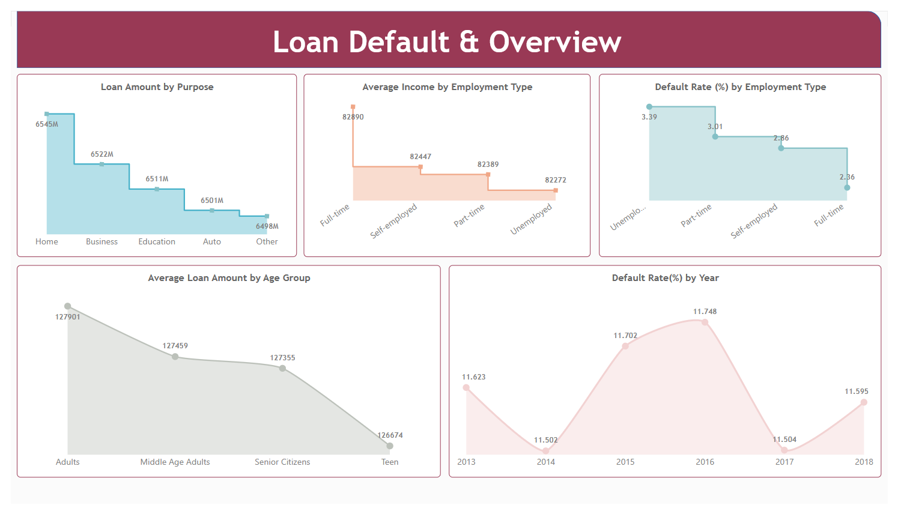
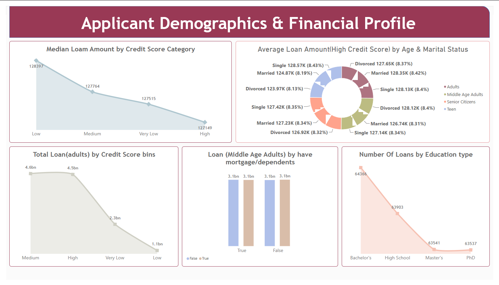
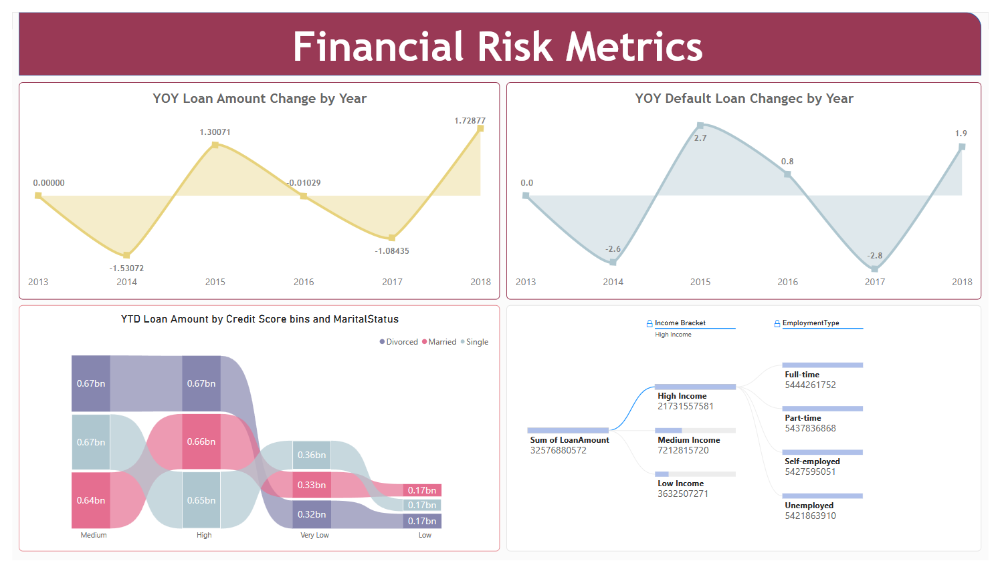

## Problem Statement

This dashboard helps analyze loan amounts and default risk across different borrower categories. It provides insights into loan purpose, employment type, age group, credit score, income bracket, marital status, education, and yearly trends.

The dashboard is divided into three pages to make it easier to explore applicant demographics, financial profiles, and loan default patterns.

## Dashboard Overview

### 1. Loan Default & Overview

This page provides an overview of loan amounts and default rates.

**Key Visuals:**
- Loan Amount by Purpose
- Average Income by Employment Type
- Default Rate (%) by Employment Type
- Average Loan Amount by Age Group
- Default Rate (%) by Year




### 2. Applicant Demographics & Financial Profile

This page analyzes loan amounts based on applicant demographics and financial characteristics.

**Key Visuals:**
- Median Loan Amount by Credit Score Category
- Average Loan Amount for High Credit Score by Age Group and Marital Status
- Total Loan (Adults) by Credit Score Bins
- Loan Amount for Middle Age Adults by Mortgage/Dependents
- Number of Loans by Education Type




### 3. Financial Risk Metrics

This page focuses on yearly changes in loan amounts and defaults, along with loan distribution across borrower categories.

**Key Visuals:**
- YoY Loan Amount Change by Year
- YoY Default Loans Change by Year
- YTD Loan Amount by Credit Score Bins and Marital Status
- Loan Amount by Income Bracket and Employment Type




## DAX Formulas Used

The following DAX expressions are used in the dashboard. They are grouped into calculated columns and measures for easier understanding.

### Calculated Columns

#### 1. Year

Extracts the year from the loan date.

```DAX
Year = YEAR('Loan_default'[Loan_Date_DD_MM_YYYY].[Date])
```

#### 2. Income Bracket

Groups applicants into low, medium, and high income categories.

```DAX
Income Bracket =
SWITCH(
    TRUE(),
    'Loan_default'[Income] < 30000, "Low Income",
    'Loan_default'[Income] >= 30000 && 'Loan_default'[Income] < 60000, "Medium Income",
    'Loan_default'[Income] >= 60000, "High Income"
)
```

#### 3. Credit Score Bins

Groups applicants into credit score categories.

```DAX
Credit Score Bins =
IF(
    Loan_default[CreditScore] <= 400, "Very Low",
    IF(
        'Loan_default'[CreditScore] <= 450, "Low",
        IF('Loan_default'[CreditScore] <= 650, "Medium", "High")
    )
)
```

#### 4. Age Groups

Groups applicants according to age.

```DAX
Age Groups =
IF(
    'Loan_default'[Age] <= 19, "Teen",
    IF(
        'Loan_default'[Age] <= 39, "Adults",
        IF('Loan_default'[Age] <= 59, "Middle Age Adults", "Senior Citizens")
    )
)
```

### Measures

#### 5. YOY Default Loans Change

Calculates the year-over-year percentage change in default loans.

```DAX
YOY Default Loans change =
DIVIDE(
    CALCULATE(
        COUNTROWS(FILTER('Loan_default', 'Loan_default'[Default] = TRUE())),
        'Loan_default'[Year] = YEAR(MAX('Loan_default'[Loan_Date_DD_MM_YYYY]))
    )
    -
    CALCULATE(
        COUNTROWS(FILTER('Loan_default', 'Loan_default'[Default] = TRUE())),
        'Loan_default'[Year] = YEAR(MAX('Loan_default'[Loan_Date_DD_MM_YYYY])) - 1
    ),
    CALCULATE(
        COUNTROWS(FILTER('Loan_default', 'Loan_default'[Default] = TRUE())),
        'Loan_default'[Year] = YEAR(MAX('Loan_default'[Loan_Date_DD_MM_YYYY])) - 1
    ),
    0
) * 100
```

#### 6. YOY Loan Amount Change

Calculates the year-over-year percentage change in total loan amount.

```DAX
YOY Loan Amount Change =
DIVIDE(
    CALCULATE(
        SUM('Loan_default'[LoanAmount]),
        'Loan_default'[Year] = YEAR(MAX('Loan_default'[Loan_Date_DD_MM_YYYY]))
    )
    -
    CALCULATE(
        SUM('Loan_default'[LoanAmount]),
        'Loan_default'[Year] = YEAR(MAX('Loan_default'[Loan_Date_DD_MM_YYYY])) - 1
    ),
    CALCULATE(
        SUM('Loan_default'[LoanAmount]),
        'Loan_default'[Year] = YEAR(MAX('Loan_default'[Loan_Date_DD_MM_YYYY])) - 1
    ),
    0
) * 100
```

#### 7. YTD Loan Amount

Calculates the year-to-date loan amount while retaining credit score and marital status groupings.

```DAX
YTD Loan Amount =
CALCULATE(
    SUM('Loan_default'[LoanAmount]),
    DATESYTD('Loan_default'[Loan_Date_DD_MM_YYYY].[Date]),
    ALLEXCEPT(
        'Loan_default',
        Loan_default[Credit Score Bins],
        Loan_default[MaritalStatus]
    )
)
```

#### 8. Average Loan Amount (High Credit)

Calculates the average loan amount for applicants in the High credit score category.

```DAX
Average Loan Amt (High Credit) =
AVERAGEX(
    FILTER('Loan_default', 'Loan_default'[Credit Score Bins] = "High"),
    'Loan_default'[LoanAmount]
)
```

#### 9. Loans by Education Type

Counts rows with a nonblank Loan ID.

```DAX
Loans by Education type =
COUNTROWS(
    FILTER('Loan_default', NOT(ISBLANK('Loan_default'[LoanID])))
)
```

#### 10. Median by Credit Score Bins

Calculates the median loan amount.

```DAX
Median by Credit score bins =
MEDIANX('Loan_default', 'Loan_default'[LoanAmount])
```

#### 11. Total Loan (Credit Bins)

Calculates the total loan amount for Adults while retaining the specified age and credit score fields.

```DAX
Total Loan (Credit Bins) =
CALCULATE(
    SUM('Loan_default'[LoanAmount]),
    'Loan_default'[Age Groups] = "Adults",
    ALLEXCEPT(
        'Loan_default',
        'Loan_default'[Age],
        'Loan_default'[Age Groups],
        'Loan_default'[CreditScore],
        'Loan_default'[Credit Score Bins]
    )
)
```

#### 12. Total Loan (Middle Age Adults)

Calculates the total loan amount for Middle Age Adults.

```DAX
Total Loan (Middle Age Adults) =
SUMX(
    FILTER('Loan_default', 'Loan_default'[Age Groups] = "Middle Age Adults"),
    'Loan_default'[LoanAmount]
)
```

#### 13. Average Income by Employment Type

Calculates average income by employment type.

```DAX
Average Income by Employment type =
CALCULATE(
    AVERAGE('Loan_default'[Income]),
    ALLEXCEPT('Loan_default', 'Loan_default'[EmploymentType])
)
```

#### 14. Average Loan by Age Group

Calculates the average loan amount across age groups.

```DAX
Average Loan by Age Group =
AVERAGEX(
    VALUES('Loan_default'[Age Groups]),
    AVERAGE('Loan_default'[LoanAmount])
)
```

#### 15. Default Rate by Employment Type

Calculates the default rate as a percentage, grouped by employment type.

```DAX
Default Rate by Employment type =
VAR totalrecords = COUNTROWS(ALL('Loan_default'))
VAR DefaultCases =
    COUNTROWS(FILTER('Loan_default', 'Loan_default'[Default] = TRUE()))
RETURN
    CALCULATE(
        DIVIDE(DefaultCases, totalrecords),
        ALLEXCEPT('Loan_default', 'Loan_default'[EmploymentType])
    ) * 100
```

#### 16. Default Rate by Year

Calculates the percentage of loans marked as default for each year.

```DAX
Default Rate by Year =
VAR totalloans =
    CALCULATE(
        COUNTROWS('Loan_default'),
        ALLEXCEPT('Loan_default', Loan_default[Year])
    )
VAR default =
    CALCULATE(
        COUNTROWS(FILTER('Loan_default', 'Loan_default'[Default] = TRUE())),
        ALLEXCEPT('Loan_default', Loan_default[Year])
    )
RETURN
    DIVIDE(default, totalloans) * 100
```

#### 17. Loan Amount by Purpose

Calculates the sum of nonblank loan amounts.

```DAX
Loan Amount by Purpose =
SUMX(
    FILTER('Loan_default', NOT(ISBLANK('Loan_default'[LoanAmount]))),
    'Loan_default'[LoanAmount]
)
```

## Key Insights

- Home loans have the largest loan amount among the purposes displayed.
- The displayed default rate is highest for unemployed applicants and lowest for full-time employees.
- Average loan amount is highest for Adults and lowest for Teens.
- Default rates and year-over-year changes vary across the years shown.
- Bachelor's degree holders have the highest loan count among the education categories displayed.
